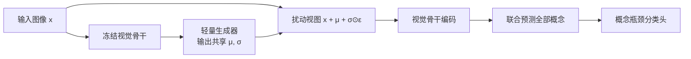

# 共享扰动视图空间加噪 CBM 设计方案

## 1. 核心设计原则

统一训练与推理的视图形式，取消背景压灰与逐概念独立加噪，改为单张共享扰动图同时监督和预测所有概念。

单张图像的扰动定义为：

\[
\widetilde{x} = x + \mu(x) + \sigma(x) \odot \epsilon, \qquad \epsilon \sim \mathcal{N}(0, I)
\]

- **训练阶段**：每次前向采样高斯噪声 $\epsilon$；
- **推理阶段**：固定随机种子进行评估，保证结果严格可复现；
- **全局共享**：单张输入图仅生成一个扰动图 $\widetilde{x}$，一次通过骨干网络同时预测全部概念。

## 2. 方案对比与架构流程

| 维度 | 逐概念独立加噪（旧设计） | 共享扰动视图（新设计） |
|---|---|---|
| **前向次数** | 为每个概念分别生成扰动图，执行 $K$ 次骨干前向 | 生成单张扰动图，仅执行 1 次骨干前向 |
| **监督范围** | 每次扰动仅随机监督 1 个概念 | 同一次前向联合监督全部 $K$ 个概念 |
| **扰动目标** | 针对单一概念区域产生均值偏移 | 联合保留全部前景概念，背景统一承受随机扰动 |

## 3. 全概念联合监督损失

为避免单样本训练时概念监督被稀疏抽样摊薄，处理视图损失拓展为全概念二元交叉熵：

\[
L_{\mathrm{concept}} = \frac{1}{K}\sum_{k=1}^{K} \mathrm{BCE}\big(c_k(\widetilde{x}), y_k\big)
\]

对于正样本较稀疏的数据集（如 CUB），引入正负样本损失加权，防止少数正概念被主导的负标签淹没。

## 4. 计算复杂度对比

| 阶段 | 逐概念加噪开销 | 共享扰动视图开销 |
|---|---|---|
| **训练** | 需对不同概念重复前向与反向 | 扰动图仅一次前向与反向，全概念损失在共享特征上并行计算 |
| **推理** | 每张图需 $K$ 次视觉编码（如 CUB 需 113 次，CIFAR-100 需 129 次） | 原图特征编码一次生成参数，扰动图编码一次预测概念，固定为 2 次 |

## 5. 骨干网络选型

选用 **CLIP ViT-B/16**：
- 相比 ViT-L/14（24 层），ViT-B/16 为 12 层 Transformer，大幅降低像素扰动反向传播时的显存与计算开销；
- 在 224×224 输入分辨率下，保留 $14 \times 14$ 的 patch 网格，能够较好定位局部概念区域（优于 ViT-B/32 的 $7 \times 7$ 网格）。
